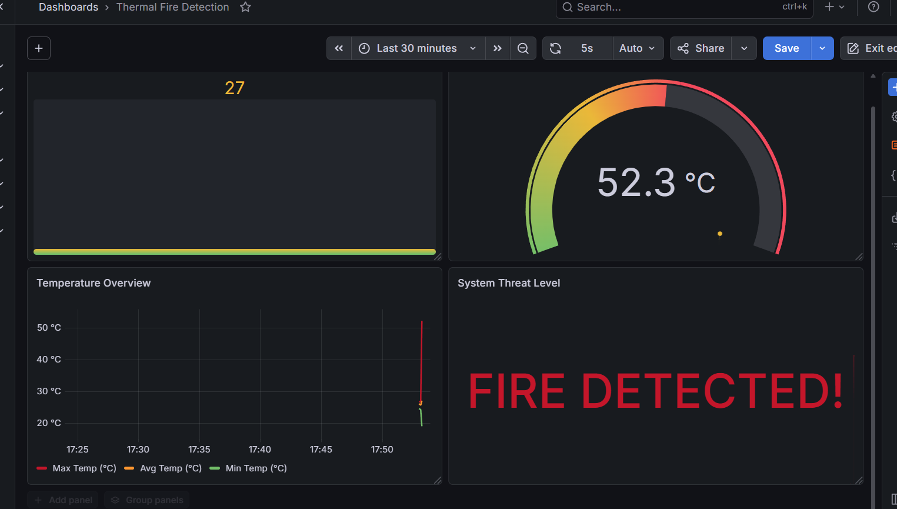
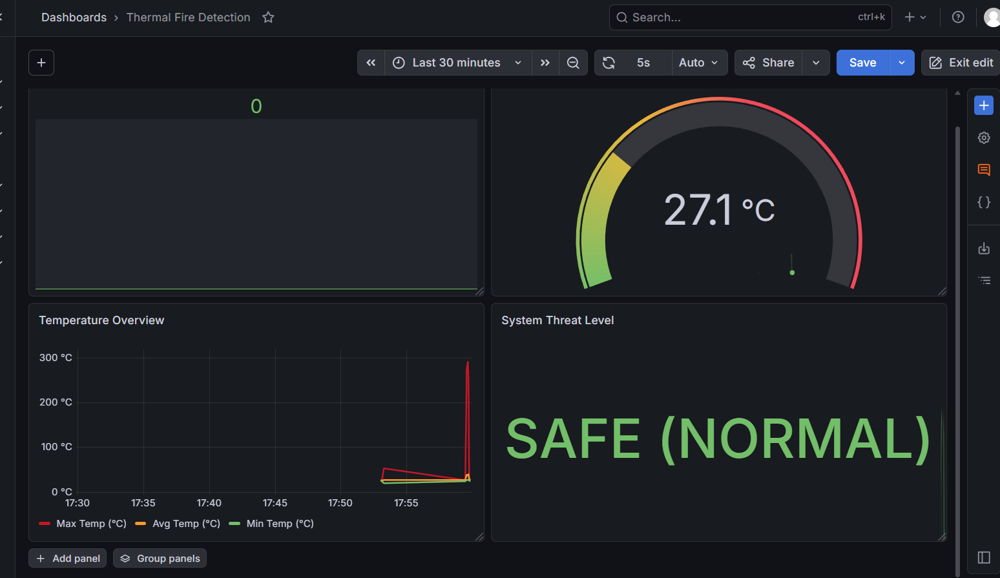
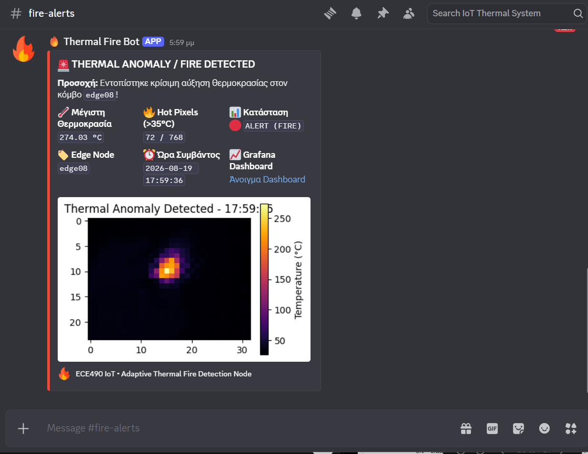
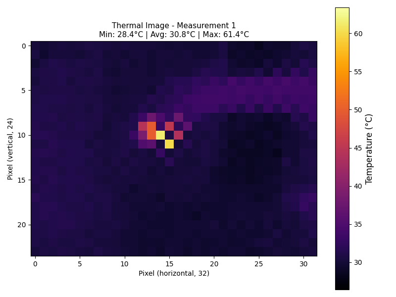
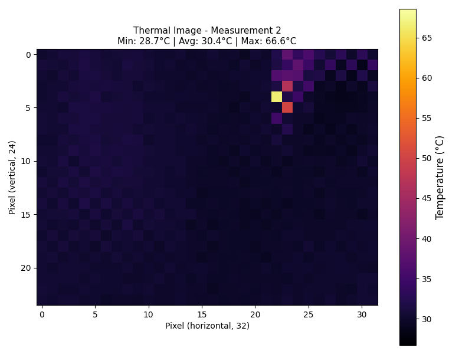
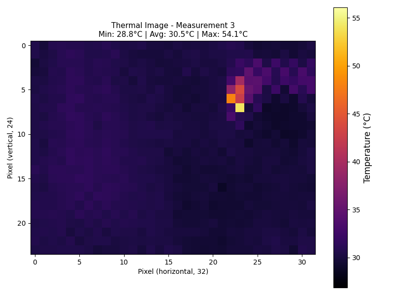

# 🌡️ Adaptive Thermal Fire Detection System — ECE490 IoT Project

A real-time, adaptive IoT edge monitoring system for thermal anomaly and fire detection built with a **Raspberry Pi 4** and an **MLX90640** Far-Infrared (FIR) thermal camera. 

The edge node processes thermal frames locally, extracts statistical temperature metrics, dynamically adapts its sampling frequency based on detected threat levels, streams telemetry via MQTT, persists time-series data into InfluxDB, visualizes metrics on Grafana, and broadcasts instant emergency alerts with attached thermal heatmaps to Discord.

---

## 📌 Project Overview

This project was developed for the **ECE490: Internet of Things** course at the **Department of Electrical and Computer Engineering, University of Thessaly**.

📄 **Full Technical Report:** [`thermal_project_final_report.pdf`](thermal_project_final_report.pdf)

### Key Capabilities:
- **Edge Computing:** Reads a 32x24 thermal matrix (768 temperature points) over I2C Fast-Mode (400 kHz) and analyzes frames locally.
- **Adaptive 3-State Machine:** Automatically adjusts sampling rate:
  - `NORMAL` (5.0s interval) — Low-power baseline monitoring.
  - `WATCH` (2.0s interval) — Elevated heat observation (T_max ≥ 40°C).
  - `ALERT` (0.5s interval) — Real-time high-speed fire tracking (T_max ≥ 50°C for ≥ 3s).
- **Zero SD Card Wear:** Generates all thermal heatmaps directly in RAM memory (`io.BytesIO`) without writing temporary files to disk.
- **MQTT Telemetry & Alerts:** Differentiated QoS levels (QoS 0 for telemetry/images, QoS 1 for critical fire alarms).
- **Time-Series Storage:** Streams line-protocol data to central InfluxDB for live Grafana dashboard visualization.
- **Multi-Channel Incident Response:** Dispatches rich Discord Webhook cards with live stats, direct Grafana links, and embedded thermal heatmap photos.

---

## 📸 Live System Previews

### 📊 1. Grafana Monitoring Dashboard
Live telemetry queried from InfluxDB displaying real-time gauges, time-series temperature trends, threat level status, and active hot pixel counts:

| (a) Active Fire Alert State (`FIRE DETECTED!`) | (b) Normal Safe State (`SAFE NORMAL`) |
| :---: | :---: |
|  |  |

---

### 🚨 2. Instant Discord Incident Alert with In-Memory Heatmap
When a fire is confirmed, the node generates a false-color heatmap in RAM and posts an instant emergency notification card to the `#fire-alerts` Discord channel:

<p align="center">
  
</p>

---

### 🖼️ 3. Thermal Heatmap Captures (Distance Tests)
Heatmap images captured during flame tests at various distances ($1.0\text{m} - 3.0\text{m}$):

| 1.0 Meter Flame Test | 2.0 Meters Flame Test | 3.0 Meters Flame Test |
| :---: | :---: | :---: |
|  |  |  |

---

## 🔧 Hardware Setup

| Component | Details |
|-----------|---------|
| **Edge Controller** | Raspberry Pi 4 Model B (Hostname: `edge08`, 4GB RAM) |
| **Thermal Sensor** | Adafruit MLX90640 (32x24 FIR Array, 55°x35° FOV, -40°C to 300°C) |
| **Interface** | I2C Bus 1 (Pins: SDA / SCL, Address `0x33`, 400 kHz Fast-Mode) |
| **Power Supply** | 5V / 3A DC via USB-C |

---

## 📁 Project Structure

```
thermal-camera-iot/
│
├── thermal_project_final_report.pdf  # 📄 Full Technical Report (Final PDF)
├── report_thermal_fire_detection.tex # LaTeX Source of Technical Report
├── thermal_node.py                   # Main Edge Node: Sensor capture, adaptive logic, MQTT publisher
├── subscriber_bridge.py              # Central MQTT Subscriber: InfluxDB ingestion & Discord emergency alerts
├── thermal_node.service              # Linux systemd service unit for edge node auto-start
├── subscriber_bridge.service         # Linux systemd service unit for central subscriber bridge
├── test_discord.py                   # Test script for Discord Webhook verification
├── camera_test.py                    # Step 0: Initial camera test & calibration
├── photos/                           # Thermal heatmap captures from tests
├── grafana_fire_alert.png            # Dashboard capture during active alert
├── grafana_safe_normal.png           # Dashboard capture during normal safe state
├── discord_fire_alert.png            # Discord emergency alert card capture
├── .env.example                      # Template for MQTT, InfluxDB, and Discord environment variables
├── README.md                         # Project documentation
└── .gitignore
```

---

## 🗺️ Implementation Roadmap

### ✅ Step 0 — Camera Bring-up & Calibration (`camera_test.py`)
- Connect MLX90640 over I2C bus at address `0x33`.
- Capture 768-pixel thermal arrays and compute min / avg / max statistics.
- **Status: COMPLETED**

### ✅ Step 1 — MQTT Telemetry Publisher (`thermal_node.py`)
- Publish JSON telemetry to `iot/<team>/telemetry/thermal` (QoS 0) with min/avg/max, hot pixels, and rate of rise ($\Delta T / \Delta t$).
- Publish Base64 heatmaps to `iot/<team>/heatmaps/thermal` (QoS 0).
- Publish alerts to `iot/<team>/alerts/thermal` (QoS 1).
- **Status: COMPLETED**

### ✅ Step 2 — InfluxDB Storage & Fallback Queue (`subscriber_bridge.py`)
- Automatically stream Line Protocol metrics into InfluxDB at `194.177.207.38:8086`.
- Persist: `min_temp`, `avg_temp`, `max_temp`, `hot_pixels`, and `rate_of_rise`.
- **Fail-Safe:** Any failed Influx write is automatically captured into `influx_failed_queue.csv`.
- **Status: COMPLETED**

### ✅ Step 3 — 3-Tier Adaptive State Machine & Dual Confirmation
- Dynamic transitions: `NORMAL` (5.0s) → `WATCH` (2.0s) → `ALERT` (0.5s).
- **Dual Confirmation:** Flame requires $T_{max} \ge 50^\circ\text{C}$ for $\ge 3.0$ seconds **AND** $N_{hot} \ge 3$ pixels ($R_{hot} \ge 0.39\%$) to filter out single-pixel sensor noise.
- **Status: COMPLETED**

### ✅ Step 4 — Instant Multi-Channel Alerts (Discord Webhook)
- In-memory RAM heatmap generation (`io.BytesIO`) to protect flash memory.
- Central subscriber dispatches rich Discord cards with live stats, embeds, and attached heatmap photos.
- Cooldown timer (10s) and audit logging into `alerts_history.csv`.
- **Status: COMPLETED**

### ✅ Step 5 — Production Systemd Services (`thermal_node.service`)
- Auto-start on boot and automatic crash recovery with `Restart=always`.
- **Status: COMPLETED**

---

## ⚙️ How to Run

### 1. Install Dependencies (on Raspberry Pi & Subscriber Host)
```bash
sudo apt update
sudo apt install python3-matplotlib python3-numpy i2c-tools python3-requests python3-paho-mqtt -y
pip3 install adafruit-circuitpython-mlx90640 python-dotenv --break-system-packages
```

### 2. Verify I2C Connection (on Raspberry Pi)
Ensure the MLX90640 camera is detected at address `0x33`:
```bash
sudo i2cdetect -y 1
```

### 3. Environment Configuration
Copy the template to `.env` and fill in your MQTT, InfluxDB, and Discord Webhook settings:
```bash
cp .env.example .env
nano .env
```

### 4. Run the System

#### A. Edge Node (Raspberry Pi):
```bash
python3 thermal_node.py
```

#### B. Central Subscriber Bridge (Server or PC):
```bash
python3 subscriber_bridge.py
```

---

## 🔄 Deploy as Systemd Services (Auto-Start on Boot)

To ensure the node runs automatically when the Raspberry Pi turns on:

```bash
# Copy service unit to systemd folder
sudo cp thermal_node.service /etc/systemd/system/

# Reload systemd and enable service
sudo systemctl daemon-reload
sudo systemctl enable thermal_node.service
sudo systemctl start thermal_node.service

# Check status and live logs
sudo systemctl status thermal_node.service
journalctl -u thermal_node.service -f
```

---

## 🌐 Central Infrastructure

| Service | Endpoint | Role |
|---------|----------|------|
| **MQTT Broker** | `194.177.207.38:1883` | Message transport & pub/sub broker |
| **InfluxDB** | `http://194.177.207.38:8086` | Time-series telemetry storage |
| **Grafana** | `http://194.177.207.38:3000` | Live monitoring dashboard & alerts |

---

## 👩‍💻 Author

**Kyriaki Nikolopoulou**  
Department of Electrical and Computer Engineering  
University of Thessaly, Volos, Greece (2026)
